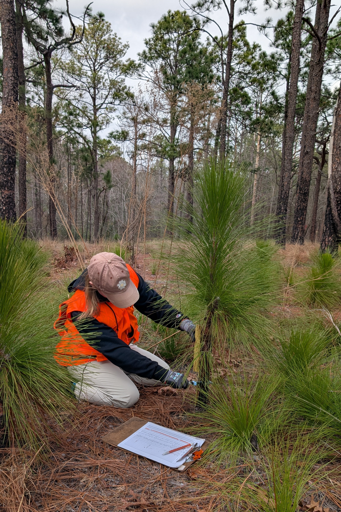
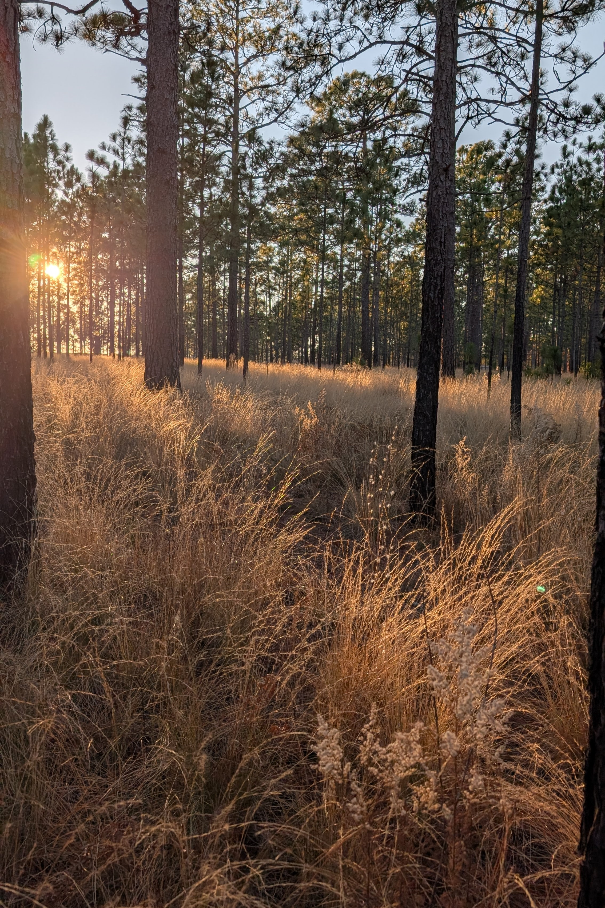
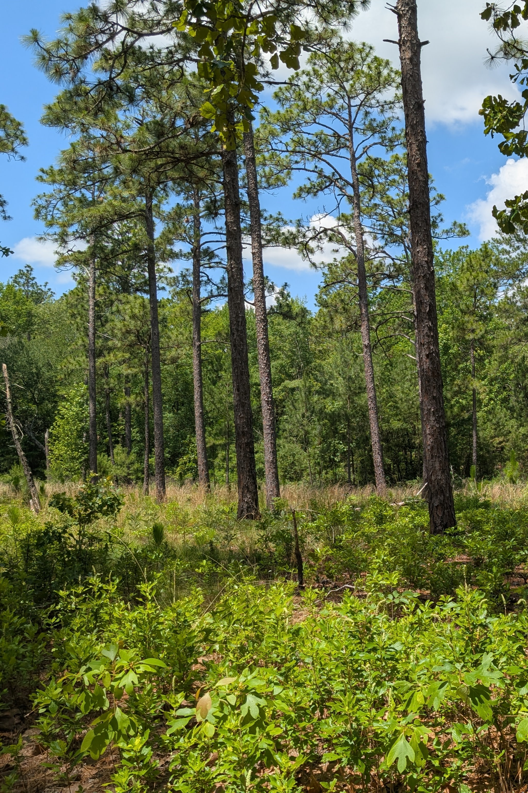

```{=html}
<div class="chapter-cards">
  <a class="chapter-card" href="#chapter-1" style="background-image: url('photos/chapter1.jpg');">
    <span class="card-label">Longleaf growth and survival</span>
  </a>
  <a class="chapter-card" href="#chapter-2" style="background-image: url('photos/chapter2.jpg');">
    <span class="card-label">Flammability and fire behavior</span>
  </a>
  <a class="chapter-card" href="#chapter-3" style="background-image: url('photos/chapter3.jpg');">
    <span class="card-label">Understory community diversity</span>
  </a>
</div>
```


::::: {#chapter-1 .chapter}
## Chapter 1: Do light and fire synergistically control stand density?

:::: {.columns}
::: {.column width="40%"}
{fig-alt="Researcher is kneeling and measuring the stem diameter of a bolting longleaf pine tree"}
:::
::: {.column width="5%"}
:::
::: {.column width="55%"}
This chapter of my dissertation is on-going, with a four-year field study that aims to determine:

- How light availability relates to growth of bolting longleaf pines
- How size relates to survival of bolting longleaf pines

:::
::::
:::::

::::: {#chapter-2 .chapter}
## Chapter 2: How do pyrophytic oaks impact the fuel load and fuel bed composition, and therefore flammability?

:::: {.columns}
::: {.column width="40%"}
{fig-alt="Longleaf pine savanna at golden hour, with the understory of grasses and forbs glowing golden in the setting sun"}
:::
::: {.column width="5%"}
:::
::: {.column width="55%"}
The field work for this chapter of my dissertation will begin very soon! I will be taking field measurements and conducting experimental burns to quantify:

- How pyrophytic oak density relates to the fuel load and the relative abundance of fuel types in the understory
- How the fuel load and relative abundance of fuel types shape fuel bed flammability and fire behavior
:::
::::
:::::

::::: {#chapter-3 .chapter}
## Chapter 3: How do pyrophytic oaks impact understory community diversity?

:::: {.columns}
::: {.column width="40%"}
{fig-alt="Longleaf pine landscape with a considerable number of hardwoods in the understory"}
:::
::: {.column width="5%"}
:::
::: {.column width="55%"}
I'm currently analyzing Carolina Vegetation Survey data, and hope to conduct a follow-up field study in Summer 2027, to investigate:

- How pyrophytic oaks in the canopy influence community composition
- How pyrophytic oaks in stunted, fire-shrub growth forms influence community composition
:::
::::
:::::